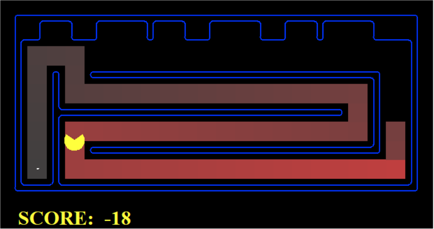
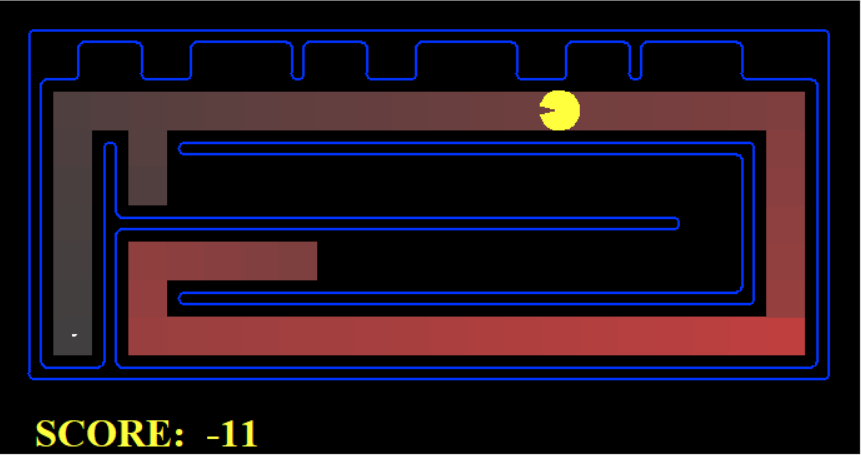

# Pacman Search

Pathfinding for Pacman with five classic search algorithms (DFS, BFS, Uniform-Cost Search, Greedy Best-First Search and A*), two multi-goal search problems with custom heuristics, and a step-by-step CSV trace of every search.

Built on the [UC Berkeley CS188](http://ai.berkeley.edu) Pacman framework as an assignment for the Artificial Intelligence course (AI2002).

| Greedy Best-First Search: falls into the trap, cost 61 | A*: finds the shortest path, cost 31 |
|---|---|
|  |  |

*Red squares are the states each algorithm expanded. The custom maze has a corridor that points straight at the goal but dead-ends, so Greedy search follows it into a long detour while A\* takes the real shortest route.*

## What's implemented

**`search.py`**
- **Depth-First Search** with a stack and an explored set (graph search)
- **Breadth-First Search** with a queue; each state is queued at most once
- **Uniform-Cost Search**, **Greedy Best-First Search** and **A\*** sharing one priority-queue search that differs only in the priority: `g`, `h` or `g + h`. A cheaper path to a state already in the frontier updates its priority.
- **CSV trace logging**: every search writes one row per expanded node (frontier before and after, explored set, `g`, `h`, `f`) to `evidence/`

**`searchAgents.py`**
- **CornersProblem**: state is `(position, visited_corners)`
- **cornersHeuristic**: shortest Manhattan route through the unvisited corners (admissible and consistent)
- **foodHeuristic**: for every pair of remaining dots `a, b`, `min(d(p,a), d(p,b)) + d(a,b)` using real maze distances (admissible and consistent)
- **Closest-dot search** with BFS

**`layouts/24K3068Search.lay`**: custom maze designed to show where Greedy search fails.

## Results

| Problem | Algorithm | Path cost | Nodes expanded |
|---|---|---|---|
| mediumMaze | BFS | 68 | 269 |
| mediumMaze | Greedy (Manhattan) | 74 | 78 |
| mediumMaze | A\* (Manhattan) | 68 | 221 |
| bigMaze | UCS | 210 | 620 |
| bigMaze | A\* (Manhattan) | 210 | 549 |
| mediumCorners | BFS | 106 | 1,966 |
| mediumCorners | A\* + cornersHeuristic | 106 | 741 |
| trickySearch (all food) | UCS | 60 | 16,688 |
| trickySearch (all food) | A\* + foodHeuristic | 60 | **353** |
| Custom maze | Greedy (Manhattan) | 61 | 63 |
| Custom maze | A\* (Manhattan) | **31** | **56** |

The CS188 autograder passes every question (26/25; the food heuristic earns the extra credit).

## Running it

Requires Python 3 (tkinter is used for the graphics).

```bash
# A* on the custom maze
python pacman.py -l 24K3068Search -p SearchAgent -a fn=astar,heuristic=manhattanHeuristic

# Greedy Best-First Search on the same maze
python pacman.py -l 24K3068Search -p SearchAgent -a fn=gbfs,heuristic=manhattanHeuristic

# Other algorithms: fn=dfs, fn=bfs, fn=ucs
python pacman.py -l bigMaze -z .5 -p SearchAgent -a fn=bfs

# Visit all four corners with A*
python pacman.py -l mediumCorners -p AStarCornersAgent -z .5

# Eat all the food with A*
python pacman.py -l trickySearch -p AStarFoodSearchAgent

# Run the autograder
python autograder.py
```

Add `-q` to skip the graphics. Trace logs are written to `evidence/`.

## Credits

The Pacman framework (game engine, graphics, autograder and layouts) was developed at UC Berkeley for CS188. The search algorithms, problem formulations, heuristics, trace logging and custom maze in this repository are the assignment work.
